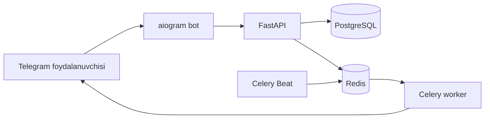

<div align="center">

# Smart HR Bot

**Davomat, vazifalar va jamoa hisoboti — Telegram ichida.**

Kompaniyalar uchun aiogram, FastAPI, PostgreSQL va Celery asosidagi HR avtomatlashtirish MVP loyihasi.


</div>

---

## Nimalar bor?

- **Davomat:** Telegram’dan joylashuv yuborib check-in/check-out qilish, ofis geofence’ini tekshirish va kechikish daqiqalarini hisoblash.
- **Xodimlar:** taklif kodi yoki havolasi bilan ro‘yxatdan o‘tish, admin va xodim rollarini ajratish.
- **Vazifalar:** admin paneldan xodim tanlash, topshiriq va muddat berish; xodim rasm, fayl yoki izoh bilan topshiradi; admin tasdiqlaydi.
- **Admin menyusi:** xodim qo‘shish, vazifa biriktirish va ofis joylashuvini Telegram’dan boshqarish.
- **Hisobotlar:** davomat va vazifalar bo‘yicha Excel hamda PDF eksporti.
- **Avtomatik xabarlar:** har kuni 08:45 da check-in eslatmasi, 18:30 da adminlarga kunlik hisobot.

## Arxitektura



Bot admin harakatlarini FastAPI’ga yuboradi. Celery/Redis eslatma, hisobot va xabarlarni fon rejimida bajaradi.

## Tez ishga tushirish

### 1. Muhit faylini sozlash

```powershell
Copy-Item .env.example .env
```

`.env` ichida quyidagilarni o‘zingizning qiymatlaringiz bilan almashtiring:

| O‘zgaruvchi | Qiymat |
|---|---|
| `TELEGRAM_BOT_TOKEN` | BotFather bergan token |
| `TELEGRAM_BOT_USERNAME` | Bot username’i, `@` belgisiz |
| `JWT_SECRET` | Uzun, tasodifiy maxfiy kalit |
| `POSTGRES_PASSWORD` | Kuchli database paroli |
| `DATABASE_URL` | PostgreSQL login/paroli va baza nomiga mos URL |
| `BOOTSTRAP_ADMIN_PASSWORD` | Dastlabki admin paroli |

`.env.example` dagi parollar faqat namuna. Ommaviy repozitoriyga `.env` ni hech qachon qo‘shmang.

### 2. Xizmatlarni ishga tushirish

```powershell
docker compose up --build -d
```

- API va Swagger: <http://localhost:8000/docs>
- Health check: <http://localhost:8000/health>

Boshlang‘ich admin username’i `BOOTSTRAP_ADMIN_USERNAME` qiymatidan, paroli esa `BOOTSTRAP_ADMIN_PASSWORD` qiymatidan olinadi.

### 3. Telegram adminini ulash

Telegram admin menyusi uchun admin foydalanuvchining Telegram ID raqami bazada bo‘lishi kerak. Yangi o‘rnatishda `BOOTSTRAP_ADMIN_TELEGRAM_ID` ni birinchi ishga tushirishdan oldin sozlang. Yoki Swagger’da boshlang‘ich admin bilan kirib, `POST /api/users` orqali Telegram ID ulangan admin yarating:

```json
{
  "full_name": "HR Admin",
  "role": "admin",
  "telegram_id": 123456789,
  "username": "hr_manager",
  "password": "kamida-8-belgi"
}
```

Ulangan admin botda `/start` yuborgach **👨‍💼 Admin Panel** tugmasini ko‘radi.

## Botdan foydalanish

### Xodim

| Buyruq yoki tugma | Amal |
|---|---|
| `/start` | Taklif havolasi/kodi orqali ulanish |
| `/checkin` | Ofis hududida ish kunini boshlash |
| `/checkout` | Ish kunini tugatish |
| `/tasks` | Biriktirilgan vazifalarni ko‘rish |
| `/starttask <id>` | Vazifani boshlash |
| `/done <id>` | Dalil yoki izoh bilan vazifani topshirish |
| `/attendance` | Joriy oy davomatini ko‘rish |

### Admin

**👨‍💼 Admin Panel** ichida:

1. **Yangi xodim qo‘shish** — ism-familiyani kiriting; bot taklif havolasi yoki `/start <kod>` buyrug‘ini beradi.
2. **Vazifa biriktirish** — xodimni tanlang, vazifa nomi va tavsifini kiriting, muddatni `YYYY-MM-DD HH:MM` formatida yozing. Muddat bo‘lmasa `-` yuboring.
3. **Ofis sozlash** — ofis nomini kiriting, so‘ng joylashuvini yuboring. Standart radius 100 metr, ish boshlanish vaqti 09:00.

Bot Telegram’dan bir martalik joriy joylashuvni oladi. Telegram botlari foydalanuvchidan Live Location ulashishni majburan so‘ray olmaydi.

## API yo‘llari

Himoyalangan endpointlar `Authorization: Bearer <token>` talab qiladi. Tokenni `POST /api/auth/login` orqali oling.

| Endpoint | Vazifasi |
|---|---|
| `POST /api/auth/login` | Admin tokeni olish |
| `/api/users` | Xodim va adminlarni boshqarish |
| `/api/offices` | Ofis va geofence sozlamalari |
| `/api/attendance` | Davomat yozuvlari va oylik ko‘rsatkichlar |
| `/api/tasks` | Vazifalar, topshirish va admin tasdig‘i |
| `/api/reports.xlsx` | Excel hisobot |
| `/api/reports.pdf` | PDF hisobot |

API’ning to‘liq hujjatlari `/docs` sahifasida.

## Asosiy jadvallar

- `users` — Telegram ID, ism, telefon, rol va faollik.
- `offices` — koordinata, radius va ish boshlanish vaqti.
- `attendance` — check-in/check-out, joylashuv va kechikish.
- `tasks` — topshiriq, ijro holati, dalil va admin tekshiruvi.

## Xavfsizlik va ishga tayyorlash

- `.env` va shaxsiy `.env.*` fayllar `.gitignore` hamda `.dockerignore` orqali chiqarib tashlanadi.
- GitHub’ga faqat `.env.example` dagi namunaviy qiymatlar yuboriladi.
- Bot tokeni ochilib qolgan bo‘lsa, BotFather’dan yangisini oling.
- PostgreSQL va JWT uchun namunaviy qiymatlarni ishlab chiqarish muhitida ishlatmang.
- Jadval sxemasi hozir SQLAlchemy `create_all` bilan yaratiladi; keyingi relizlarda Alembic migratsiyalarini qo‘shish tavsiya etiladi.

## Texnologiyalar

Python 3.11+ · aiogram 3 · FastAPI · SQLAlchemy 2 · PostgreSQL · Celery · Redis · Docker Compose
